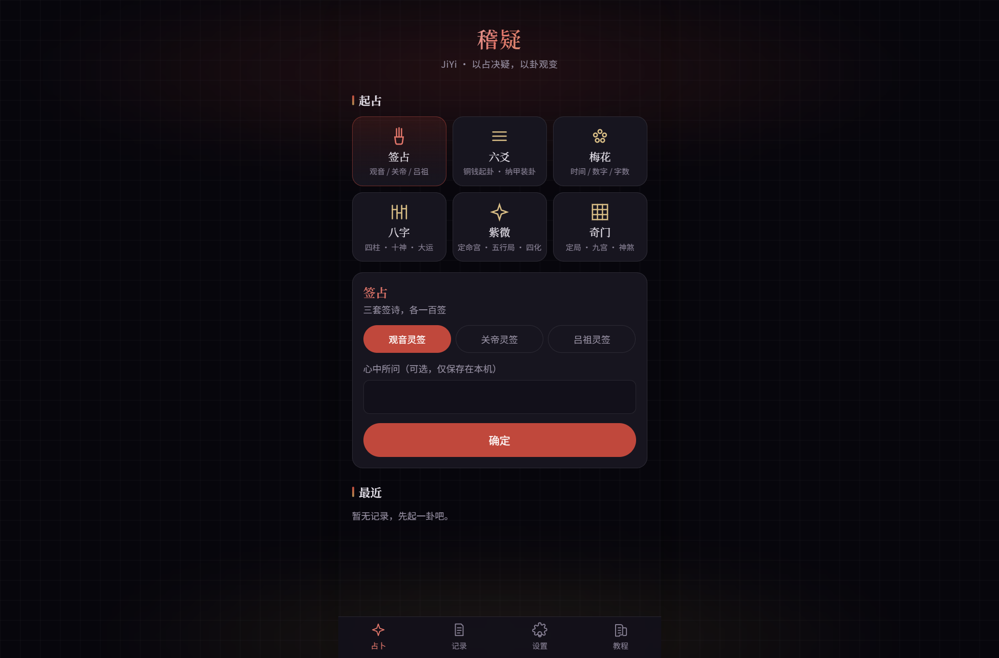
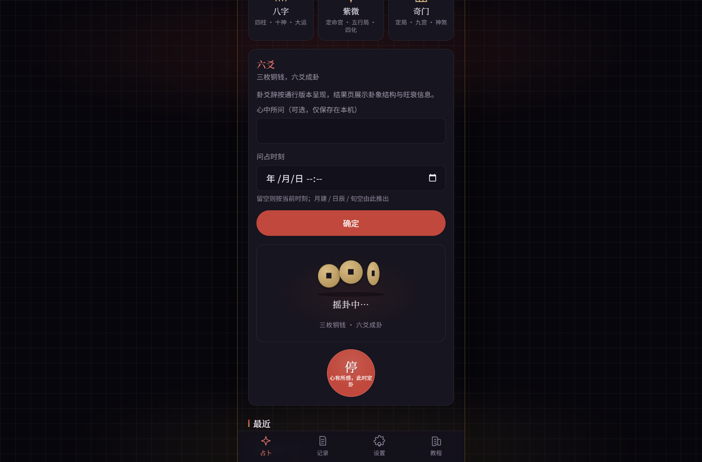
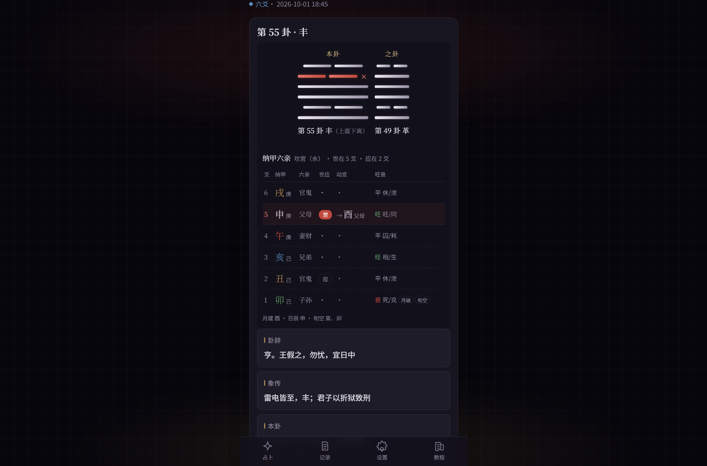
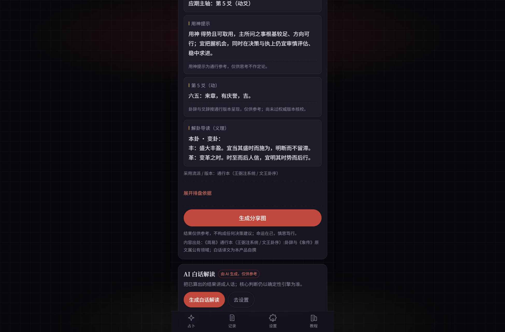
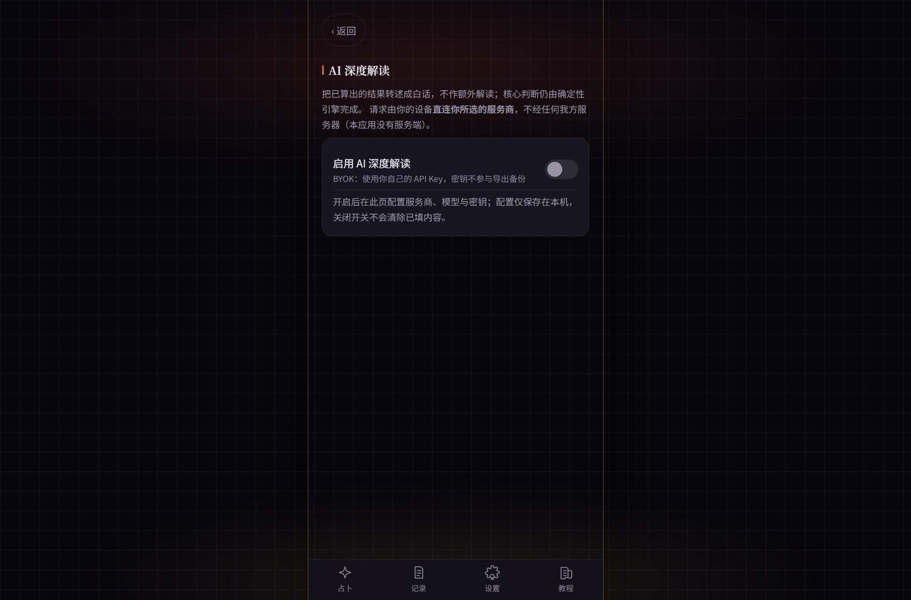
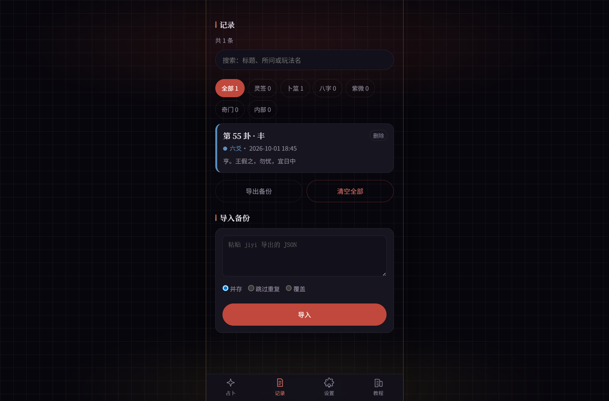
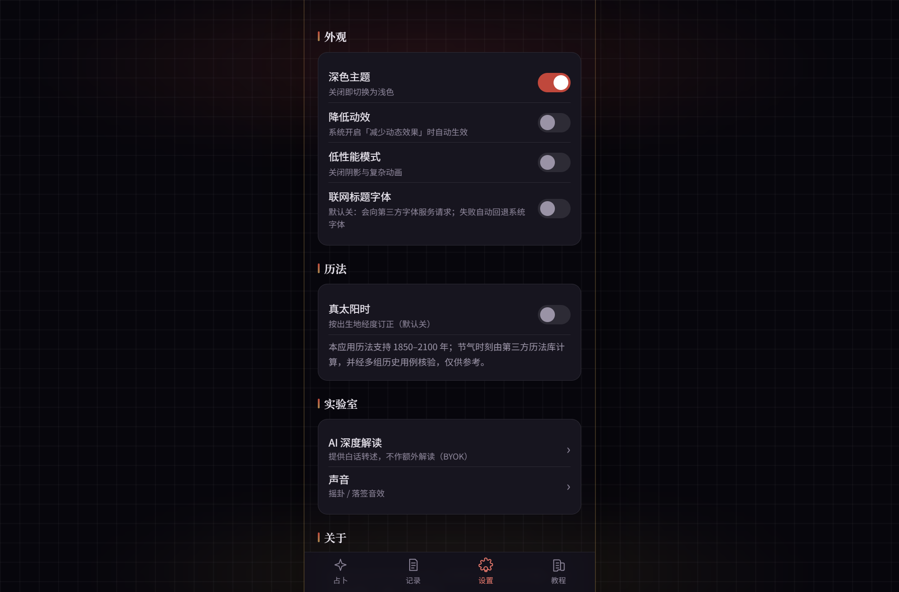
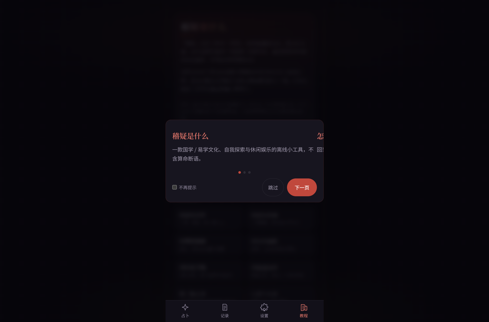

<div align="center">


# JiYi (稽疑)

**Resolve doubt through casting; observe change through hexagrams** — a fully offline, front-end-only
toolkit for traditional Chinese Yi-learning (易学) practices. Ships as an Android app and a web app.

[](tests)


[简体中文](README.md) · **English**

</div>

**JiYi (稽疑)** is an offline-first divination toolkit covering six traditional practices. Every
calculation runs **on your device** — no sign-up, no login, nothing is uploaded. Bring your own API key
and JiYi can additionally generate a plain-language reading for each cast (optional, off by default).

> All output — divination results and AI-generated text alike — is for entertainment and cultural
> reference only. It is not advice of any kind.

## Contents

- [Features](#features)
- [Download](#download)
- [Six methods](#six-methods)
- [Screens](#screens)
- [Quick start](#quick-start)
- [Building the Android APK](#building-the-android-apk)
- [Tests and CI](#tests-and-ci)
- [Project layout](#project-layout)
- [Privacy design](#privacy-design)
- [Contributing](#contributing)
- [Disclaimer](#disclaimer)
- [License](#license)

## Features

- **Fully offline**: casting, chart computation and interpretation all run locally — there is no backend
- **Your data stays yours**: records live in local storage only (cap 200) and can be exported / imported
- **Verifiable algorithms**: the engines are covered by 636 unit tests plus a golden dataset collected
  from multiple independent sources (the comparison dataset is not shipped in this repository)
- **Opt-in birth data**: BaZi and Zi Wei need birth information; nothing is persisted until you consent
- **AI deep reading (BYOK)**: bring your own key against any OpenAI-compatible endpoint. Presets only
  supply a default base URL — **you type the model name yourself**, no chat / flash / pro tiers are forced
- **Labelled AI output**: every AI block is marked "generated by AI, for reference only"
- **Motion tiers**: on low-end devices or with "reduce motion" enabled, animations collapse and results
  appear immediately
- **Built-in tutorial**: a fourth bottom tab explains what each method does and when it is used

## Download

A **signed release build is committed to this repository** — you do not have to compile anything:

| File | Size | Signature | SHA-256 |
|---|---|---|---|
| [**jiyi-release.apk**](release/jiyi-release.apk) | 3.98 MB (4,174,199 bytes) | `CN=JiYi` (v2 scheme, verified with `apksigner verify`) | `A29A2E93136AC5AC97D73BF78693ADE61B11B26FD2A0B486FC571D0F37B49C46` |

- **How to install**: transfer the APK to your phone → allow "install from unknown sources" → open it.
  Everything works **offline**; only the optional AI reading needs a network connection.
- **Requirements**: Android 7.0 (API 24) or newer, arm64 / armv7; built against `targetSdk 36`.
- **Verify**: `apksigner verify jiyi-release.apk` should print `Verifies`, or compare the SHA-256 above.
- Prefer to build it yourself? See [Building the Android APK](#building-the-android-apk).

> The APK is rebuilt whenever the code changes; if it looks out of date, rebuild before distributing.

## Six methods

| Method | What you provide | What you get |
|---|---|---|
| **Lot casting (签占)** | Pick a lot set and shake | Lot number + poem / prose explanation / allusion / source |
| **Liu Yao (六爻)** | Your question + six coin tosses + the moment of casting | Primary / moving / transformed hexagram, assembled with Na-Jia: six relatives, shi-ying, per-line strength |
| **Mei Hua (梅花易数)** | A moment, two numbers, or a sentence | Primary, nuclear and transformed hexagrams, plus the body/application (体用) relation |
| **BaZi (八字)** | Date and time of birth + gender (place optional) | Four pillars / ten gods / pattern / strength / major cycles / current year / branch interactions |
| **Zi Wei Dou Shu (紫微斗数)** | Date and time of birth + gender | Life palace and elemental bureau / twelve palaces / 14 major stars / four transformations / decade cycles |
| **Qi Men Dun Jia (奇门遁甲)** | The moment of the question + a direction | Yin-yang escape and bureau number, the nine-palace plate (stars · gates · gods), timing and direction reference |

### Worked examples

**Lot casting** — pick the Guanyin set, shake, and you draw **lot 43 (upper grade)**:

> Heaven and earth meet in harmony, all things complete; self-reliance brings its own brocade;
> children and grandchildren flourish generation after generation; everything answers to the heart.

The result page also shows the prose explanation, the historical allusion and the source edition.
Three sets — Guanyin, Guandi and Lüzu — 100 lots each, 300 in total.

**Mei Hua** — you call out two numbers, **13 and 27** (casting by time or by a phrase works the same way):

- `13 % 8 = 5` → upper trigram Xun; `27 % 8 = 3` → lower trigram Li → **primary: hexagram 37, Jia Ren** (Xun over Li)
- `(13 + 27) % 6 = 4` → **moving line 4** → **transformed: hexagram 13, Tong Ren**
- lines 2-3-4 and 3-4-5 each recombine into a trigram → **nuclear: hexagram 64, Wei Ji**
- the trigram without a moving line is the body (Li · fire), the one with it is the application (Xun · wood)
  → **application generates body**

**BaZi** — born 1990-03-15 at 14:30 in Beijing (male):

- True solar time correction **−24 min** (longitude −14.4 min + equation of time −9.7 min)
  → the chart is actually cast for **14:06**
- Four pillars **Geng-Wu · Ji-Mao · Ji-Mao · Xin-Wei**, day master **Ji**, pattern taken from the month
  branch: **Seven Killings (Qi Sha)**
- Also shown: ten gods, hidden stems, day-master strength, combinational configurations, branch
  interactions, subsidiary star influences, **eight major cycles** (with starting age and direction) and
  the current year
- Every convention is visible: late Zi hour counted with the same day, year changing at Li Chun, leap
  months split by solar term — all expandable for checking

**Zi Wei Dou Shu** — same birth data:

- Life palace **Jia-Shen**, **water bureau 2**; the twelve palaces run counter-clockwise from the life
  palace: self (Shen), siblings (Wei), spouse (Wu), children (Si), wealth (Chen)…
- Placement of the 14 major stars, the four transformations by year stem and their palaces, plus
  auxiliary and minor stars
- **Decade cycles run forward, starting at age 2** (life palace rules ages 2–11), with the current year
- Uses the **San He (three-harmony) school**, stated explicitly on the result page

**Liu Yao** — you ask "will this deal go through?", casting at 2026-03-20 10:30:

- Six coin tosses produce the primary / moving / transformed hexagram, then Na-Jia assembly adds the
  **six relatives, shi-ying, and the moving and changed lines**
- The casting moment yields **month branch Mao, day branch Si, void branches Wu and Wei** → per-line
  strength with **explainable reasoning** (five states of the month branch, five uses of the day branch,
  month break, hidden activation, day break, void)
- Results and reasoning are shown separately; the strength quantification is labelled
  "provisional, per common practice (Zeng Shan Bu Yi system)" rather than presented as a verdict

**Qi Men Dun Jia** — you ask "which direction suits tomorrow's meeting?", at 2026-03-20 10:30:

- Bureau determined by the Chai Bu method → **yang escape 7, middle third of Jing Zhe**
  (hour pillar Ding-Si, day pillar Gui-Si)
- The nine-palace plate: earthly branch with the three wonders and six instruments, the heavenly plate
  (nine stars / heavenly stems / eight gates), the eight gods, the lead star and lead gate, void and
  the horse star
- The reading explains **traditional usage conventions** and shows this bureau's structure (which palace
  and direction each gate lands in) — **no auspicious/inauspicious verdicts, no timing predictions**

## Screens

| Home | Liu Yao · casting | Liu Yao · hexagram detail | AI reading |
|---|---|---|---|
|  |  |  |  |

| AI settings | Records | Settings | Tutorial |
|---|---|---|---|
|  |  |  |  |

## Quick start

Download or clone this repository, then run from the project root:

```bash
npm install
npm run dev        # dev server
npm run verify     # typecheck + full test suite + content gate
npm run build      # emits dist/
```

Requires Node.js 20 or newer.

| Command | What it does |
|---|---|
| `npm run dev` | Start the local dev server |
| `npm run build` | Typecheck and emit the production bundle to `dist/` |
| `npm run preview` | Preview the production bundle |
| `npm run test` | Run the full unit suite |
| `npm run typecheck` | `vue-tsc --noEmit` |
| `npm run content:sync` | Content gate: content masters → `src/data/content` snapshot |
| `npm run verify` | typecheck, test and content:sync in order |

## Building the Android APK

Requires Node.js 20+, JDK 17 / 21 and the Android SDK.

```bash
npm install
npm run cap:sync           # build the web bundle and sync it into the Android project
cd android
./gradlew assembleDebug    # debug build
./gradlew assembleRelease  # release build
```

On Windows PowerShell use `.\gradlew.bat`.

Signing: copy `android/keystore.properties.template` to `android/keystore.properties` and fill in your
own `storeFile` / `storePassword` / `keyAlias` / `keyPassword`. That file is git-ignored and never
committed. Without it, a release build falls back to the debug key and is for local testing only.

Output: `android/app/build/outputs/apk/<debug|release>/`

> `npm run android:release` only runs Gradle. Always run `npm run build` and `npx cap sync android`
> first, otherwise the APK will contain a stale web bundle.

## Tests and CI

- `npm test`: in a full local workspace, **636 tests across 74 files** (engine determinism, golden
  dataset comparisons, the content gate, component behaviour, layered AI diagnostics)
- `npm run typecheck`: `vue-tsc --noEmit` — zero errors is the entry bar
- `npm run content:sync`: content gate — zero blocks is the entry bar (requires a local `DOCS/content`)
- `npm run build`: production bundle smoke test

GitHub Actions runs three gates on every push / PR — typecheck, tests and a build smoke test
(see [ci.yml](.github/workflows/ci.yml)).

> **This repository does not ship `DOCS/`**: the golden comparison data and content masters live only
> in the author's local workspace. After cloning, specs that depend on that data are skipped and
> listed in the startup log; `content:sync` prints a notice and keeps the committed content snapshot.
> The test count in a fresh clone is therefore lower than the 636 above — a deliberate, visible
> downgrade rather than a silent pass. Use a workspace containing `DOCS/` for the full check suite.

> Run the checks in this order: `content:sync → typecheck → test`. Running the typechecker while the
> sync is still generating JSON produces false "file not found" errors.

## Project layout

```
├─ src/
│  ├─ engine/          # engines: Liu Yao / Mei Hua / BaZi / Zi Wei / Qi Men / lots / calendar core
│  ├─ components/      # UI (divination/ casting animations, tutorial/ guided tour)
│  ├─ views/           # pages (home / records / detail / settings / tutorial)
│  ├─ stores/          # Pinia stores (records / settings / AI / toast)
│  ├─ platform/        # storage, backup export/import, share cards, error copy
│  └─ data/            # content snapshot and category definitions
├─ assets/screenshots/ # app screenshots referenced by this README
├─ release/            # signed APK for direct download
├─ scripts/            # content collection / sync / icon generation
├─ tests/              # vitest unit tests and golden comparisons
└─ android/            # Capacitor Android project
```

Tech stack: Vue 3 · TypeScript · Vite · Pinia · Vue Router · Capacitor 8 · lunar-typescript.

## Privacy design

| Concern | Policy |
|---|---|
| Divination records | Local storage only (`jiyi.records.v1`); exportable as a JSON backup |
| Birth data | Never saved by default; persisted only after explicit consent, revocable at any time |
| AI key | Stored locally in plaintext (`jiyi.ai.v1`); the settings page states this risk and offers one-tap wipe; excluded from backups |
| AI requests | Sent only when you tap generate; with "allow sensitive data" off, birth data never enters the request body |
| Web fonts | Off by default; enabling them is announced as a network action |
| Network | The only permission is `INTERNET`, and it is used solely for the optional AI feature |

## Contributing

Issues and pull requests are welcome:

- For bug reports, include reproduction steps, device / OS version and screenshots; for chart results
  also include the exact input parameters
- Changes to engine algorithms must come with golden cases or tests and a note on the source
  convention (golden data lives in a local `DOCS/golden` and is not committed)
- New content (lot poems, hexagram and line texts, readings) must keep its `source` / `license` fields
  and pass the content gate
- Run `npm run verify` locally before submitting — typecheck, tests and content gate must all be green

This project keeps a hard boundary: **core judgements come from deterministic engines; AI only rewrites
them into plain language**. Features that change verdicts, auspiciousness or timing should be discussed
in an issue first.

## Disclaimer

- All output, including chart readings and AI-generated text, is **for entertainment and cultural
  reference only** and is not medical, legal, investment or any other professional advice
- Results are produced algorithmically from traditional rules; they are not statements about reality
- AI-generated content may be inaccurate and is always labelled "generated by AI, for reference only"

## License

The **source code** is licensed under the [MIT License](LICENSE) — Copyright © 2026 **JiYi Authors**.
You may use, modify, distribute and sell it freely, provided the copyright and licence notice are kept.
The software is provided "as is", without warranty of any kind.

**Content master files are not covered by the MIT licence**: the lots, hexagram and line texts and
readings each carry their own `source` / `license` fields. This project does not relicense them —
follow the attribution and licence stated in each master file.

Third-party dependencies (see `package.json`) remain under their upstream licences.

## Acknowledgements

- [lunar-typescript](https://github.com/6tail/lunar-typescript) and
  [lunisolar](https://github.com/waterbeside/lunisolar) for the calendar core
- [Capacitor](https://capacitorjs.com/) for the native shell
- `taibu-core` and `iztro` as independent cross-check sources (under their respective MIT / AGPL terms)
- The editors and publishers who compiled the traditional lot and hexagram texts
