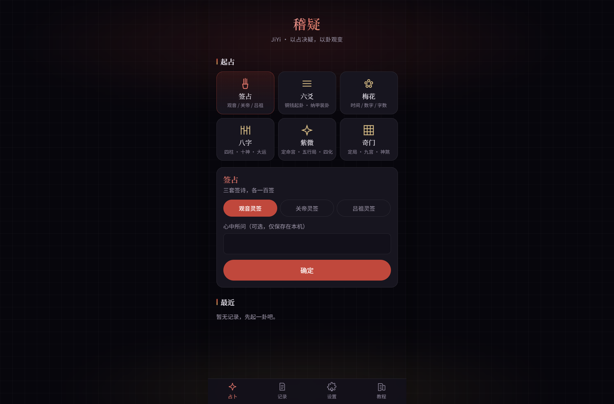
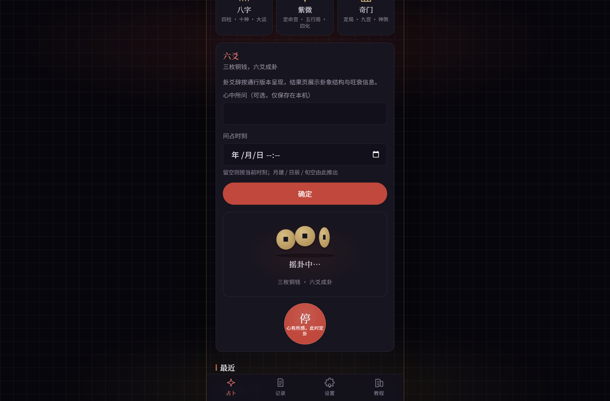
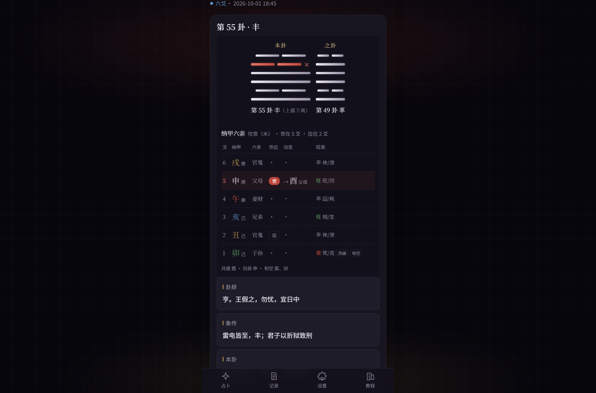
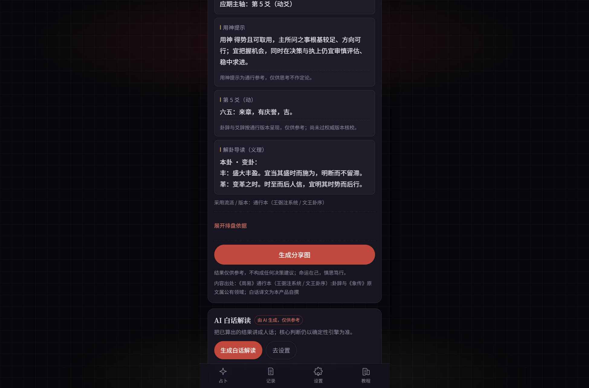
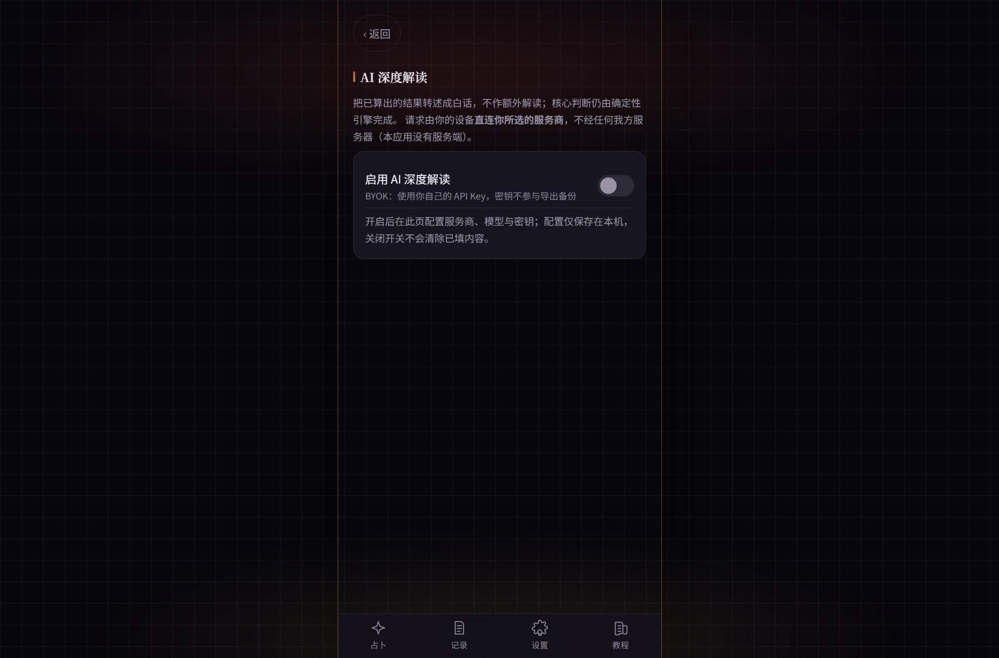
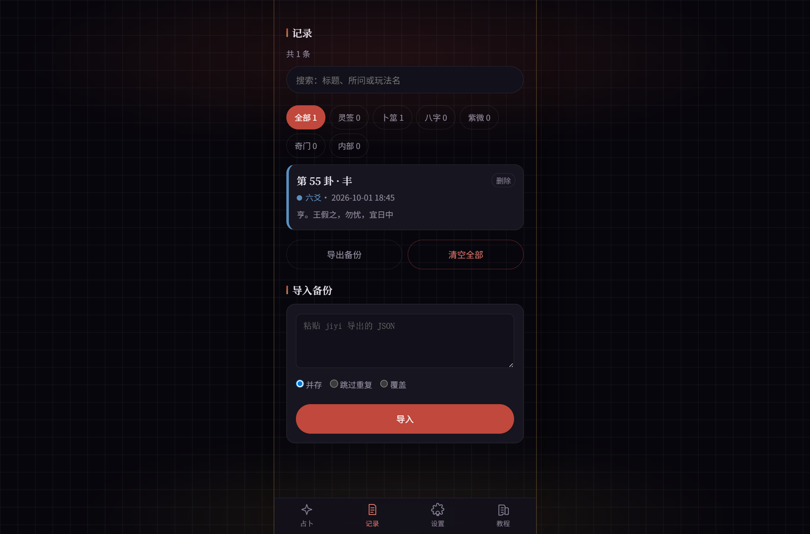
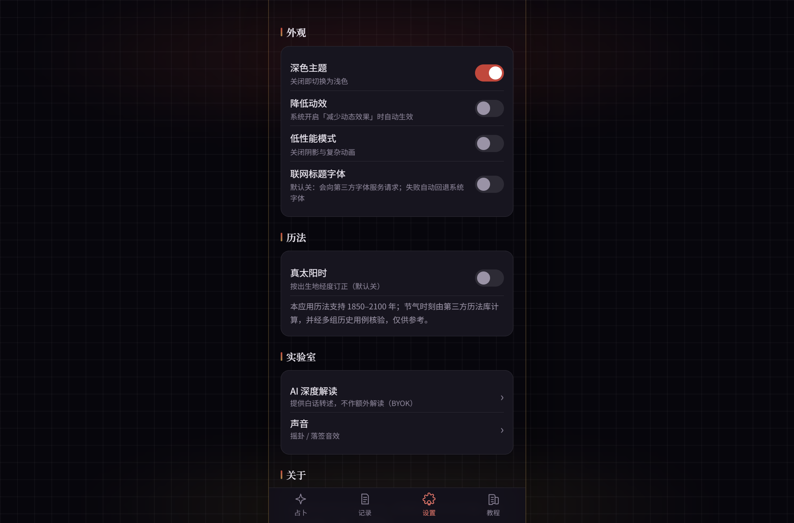
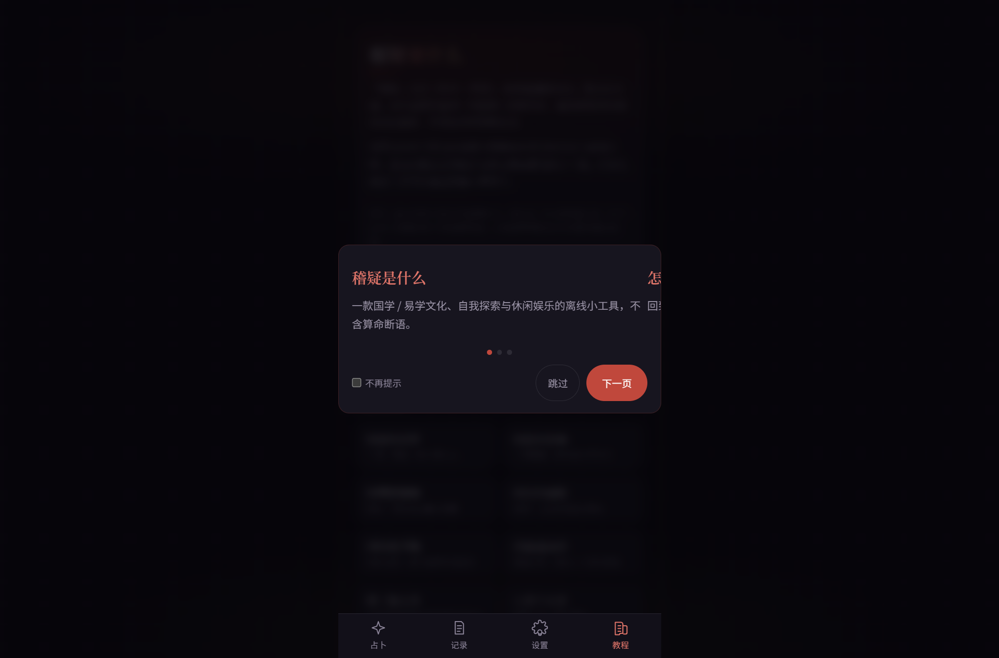

<div align="center">


# 稽疑 JiYi

**以占决疑，以卦观变** —— 纯前端、离线可用的多品类易学工具（Android App / Web）

[](tests)


**简体中文** · [English](README.en.md)

</div>

**稽疑 JiYi** 是一款纯前端、离线可用的易学占卜工具。签占、六爻、梅花、八字、紫微、奇门六种玩法开箱即占，全部排盘算法在本地完成——不注册、不登录、不上传任何数据。接入你自己的 AI 密钥后，还能对每一次占卜生成白话深度解读。

> 占卜结果与 AI 生成内容均仅供娱乐与文化参考，不构成任何建议。

## 目录

- [特性](#特性)
- [下载安装](#下载安装)
- [六种玩法](#六种玩法)
- [应用截图](#应用截图)
- [快速开始](#快速开始)
- [构建 Android APK](#构建-android-apk)
- [测试与持续集成](#测试与持续集成)
- [项目结构](#项目结构)
- [隐私设计](#隐私设计)
- [参与贡献](#参与贡献)
- [免责声明](#免责声明)
- [许可证](#许可证)

## 特性

- **完全离线**：起卦、排盘、解卦全部在本机完成，没有服务端
- **数据归你**：记录仅保存在本机（上限 200 条），支持一键导出 / 导入备份
- **算法可核验**：排盘引擎由 636 个单元测试与多来源独立 golden 数据交叉验证（对拍数据不随仓库发布）
- **出生数据授权制**：八字 / 紫微涉及出生信息，未显式授权不落盘
- **AI 深度解读（BYOK）**：自带密钥直连 OpenAI 兼容端点，知情确认后才启用；服务商只提供默认地址，**模型名由你自由填写**，不预设档位
- **AI 内容全程标注**：所有 AI 输出均标注「由 AI 生成，仅供参考」
- **动效分级**：低性能设备或系统「减弱动效」下自动 0 等待直达结果
- **内置教程**：底栏第 4 个标签讲解六种玩法是什么、传统上怎么用

## 下载安装

仓库内已放好**签名发布包**，不用自己编译：

| 文件 | 大小 | 签名 | SHA-256 |
|---|---|---|---|
| [**jiyi-release.apk**](release/jiyi-release.apk) | 3.98 MB（4,174,199 字节） | `CN=JiYi`（v2 方案，`apksigner verify` 通过） | `A29A2E93136AC5AC97D73BF78693ADE61B11B26FD2A0B486FC571D0F37B49C46` |

- **怎么装**：把 APK 传到手机 → 安装时允许「未知来源」→ 打开即用，**全程无需联网**（只有可选的 AI 深度解读需要联网）
- **系统要求**：Android 7.0（API 24）及以上，arm64 / armv7；`targetSdk 36`
- **校验**：`apksigner verify jiyi-release.apk` 应输出 `Verifies`；或比对上表的 SHA-256
- 想自己编译，见 [构建 Android APK](#构建-android-apk)

> APK 随代码更新重新构建；若版本号与最新提交不一致，请以最新构建为准。

## 六种玩法

| 玩法 | 你要给什么 | 你会得到什么 |
|---|---|---|
| **签占** | 选一套签谱，摇一摇 | 签号 + 签诗 / 解曰 / 典故 / 出处 |
| **六爻** | 心中所问 + 六次铜钱 + 问占时刻 | 本卦 / 动爻 / 之卦，并按京房纳甲装出六亲、世应、逐爻旺衰 |
| **梅花易数** | 一个时刻 / 两个数字 / 一句话 | 本卦、互卦、变卦，以及体用与五行生克关系 |
| **八字** | 出生年月日时 + 性别（可选出生地） | 四柱 / 十神 / 格局 / 强弱 / 大运 / 流年 / 刑冲合害 |
| **紫微斗数** | 出生年月日时 + 性别 | 命宫五行局 / 十二宫 / 十四正曜 / 四化 / 大限 / 流年 |
| **奇门遁甲** | 问事时刻 + 方位 | 阴阳遁与局数、九宫盘（九星·八门·八神·值符值使）、择时择方参照 |

### 实跑示例

**签占** —— 选「观音签」，摇动后落 **第 43 签（上签）**：

> 天地交泰万物全，自营自养自然锦；儿孙代代皆英发，事事如心谢圣贤。

结果页同时给出解曰、典故与版本出处。观音 / 关帝 / 吕祖三套各 100 首，共 300 首。

**梅花易数** —— 随手报两个数 **13、27**（时间起卦、字数起卦同理）：

- `13 % 8 = 5` → 上卦巽；`27 % 8 = 3` → 下卦离 → **本卦 第 37 卦 · 家人**（上巽下离）
- `(13 + 27) % 6 = 4` → **动爻在第 4 爻** → **变卦 第 13 卦 · 同人**
- 第 2/3/4 爻与第 3/4/5 爻各重组一经卦 → **互卦 第 64 卦 · 未济**
- 不动的经卦为体（离·火），动爻所在为用（巽·木）→ **用生体**

**八字** —— 1990-03-15 14:30 生于北京（男）：

- 真太阳时订正 **−24 分**（经度 −14.4 分 + 均时差 −9.7 分）→ 实际按 **14:06** 排盘
- 四柱 **庚午 · 己卯 · 己卯 · 辛未**，日主 **己**，月令取格为 **七杀格（偏官格）**
- 一并给出：十神、地支藏干、日主强弱、会局合局、刑冲合害、神煞旁参、**大运 8 步**（含起运岁数与顺逆）、当前流年
- 口径全部可见：晚子时归当日、立春换年、闰月以节气分段，可在结果页展开逐项核对

**紫微斗数** —— 同一个生日：

- 命宫 **甲申**，**水二局**；十二宫自命宫逆排：命宫申、兄弟未、夫妻午、子女巳、财帛辰……
- 十四正曜落宫、年干四化及其落宫、辅煞与杂曜
- **大限顺行，2 岁起运**（命宫主 2–11 岁），并给出当前流年
- 采用**三合派**安星，结果页明确标注流派

**六爻** —— 心中问「这笔合作能成吗」，问占时刻 2026-03-20 10:30：

- 六次铜钱成卦 → 本卦 / 动爻 / 之卦，再按京房纳甲装出**六亲、世应、动爻与变爻**
- 由问占时刻推出 **月建卯、日辰巳、旬空午未** → 逐爻旺衰，并附**可解释的依据**（月令五态、日辰五用、月破 / 暗动 / 日破 / 旬空）
- 结果与依据分开展示；旺衰量化标注为「暂按通行口径（增删卜易系统）」，不包装成定论

**奇门遁甲** —— 问「明日洽谈宜往何方」，时刻 2026-03-20 10:30：

- 拆补法定局 → **阳遁 7 局 · 惊蛰中元**（时柱丁巳、日柱癸巳）
- 九宫盘：地盘三奇六仪、天盘（九星 / 天盘干 / 八门）、八神、值符值使、空亡与驿马
- 问事取用只讲**传统取用口径**并呈现本局结构（门落宫与方位），**不作吉凶断语、不给应期**

## 应用截图

| 首页 | 六爻 · 摇卦 | 六爻 · 卦象详情 | AI 白话解读 |
|---|---|---|---|
|  |  |  |  |

| AI 设置 | 记录管理 | 设置 | 教程 |
|---|---|---|---|
|  |  |  |  |

## 快速开始

克隆或下载本仓库后，在项目根目录执行：

```bash
npm install
npm run dev        # 开发调试
npm run verify     # 类型检查 + 全量测试 + 内容闸门
npm run build      # 产出 dist/
```

环境要求：Node.js 20 及以上。

常用脚本：

| 命令 | 作用 |
|---|---|
| `npm run dev` | 启动本地开发服务 |
| `npm run build` | 类型检查并产出生产包到 `dist/` |
| `npm run preview` | 预览生产包 |
| `npm run test` | 运行全部单元测试 |
| `npm run typecheck` | `vue-tsc --noEmit` 全量类型检查 |
| `npm run content:sync` | 内容闸：内容母版 → `src/data/content` 快照 |
| `npm run verify` | 依次执行 typecheck、test、content:sync |

## 构建 Android APK

需要 Node.js 20+、JDK 17 / 21、Android SDK。

```bash
npm install
npm run cap:sync                # 构建 Web 产物并同步进 Android 工程
cd android
./gradlew assembleDebug         # 调试包
./gradlew assembleRelease       # 发布包
```

Windows PowerShell 下使用 `.\gradlew.bat`。

签名：把 `android/keystore.properties.template` 复制为 `android/keystore.properties`，填入你自己的 `storeFile` / `storePassword` / `keyAlias` / `keyPassword`。该文件已被 `.gitignore` 排除，不会入库；未配置签名时 Release 包回退为 debug 签名，仅供本机测试。

产物路径：`android/app/build/outputs/apk/<debug|release>/`

> `npm run android:release` 只跑 Gradle。请先执行 `npm run build` 与 `npx cap sync android`，否则 APK 里会带旧的前端产物。

## 测试与持续集成

- `npm test`：本地完整工作区下 **636 个单元测试 / 74 个测试文件**（引擎确定性、golden 数据对拍、内容闸、组件行为、AI 分层诊断）
- `npm run typecheck`：`vue-tsc --noEmit`，0 错误为准入线
- `npm run content:sync`：内容闸门，`0 block` 为准入线（需要本地 `DOCS/content`）
- `npm run build`：生产包构建冒烟

GitHub Actions 在 push / PR 时执行三道门禁：类型 → 测试 → 构建冒烟（见 [ci.yml](.github/workflows/ci.yml)）。

> **本仓库不提供 `DOCS/`**：引擎对拍数据与内容母版只存在于作者本地工作区。克隆后运行测试时，依赖对拍数据的用例会自动跳过并在启动日志中逐条列明；`content:sync` 会提示跳过，并沿用已入库的内容快照。因此发布仓库的测试数量会少于上表的 636，这是预期降级，不是静默通过。需要完整校验请使用包含 `DOCS/` 的本地工作区。

> 本地跑检查时请按 `content:sync → typecheck → test` 的顺序执行：内容闸还在生成 JSON 时跑类型检查会出现「文件不存在」的假错误。

## 项目结构

```
├─ src/
│  ├─ engine/          # 排盘引擎：六爻 / 梅花 / 八字 / 紫微 / 奇门 / 签占 / 历法底座
│  ├─ components/      # UI 组件（divination/ 起占过程动画、tutorial/ 教程）
│  ├─ views/           # 页面（首页 / 记录 / 详情 / 设置 / 教程）
│  ├─ stores/          # Pinia 状态（记录 / 设置 / AI / Toast）
│  ├─ platform/        # 存储、导出备份、分享图、错误文案
│  └─ data/            # 内容快照与品类定义
├─ assets/screenshots/ # README 引用的应用截图
├─ release/            # 可直接下载的签名发布包
├─ scripts/            # 内容采集 / 同步 / 图标生成脚本
├─ tests/              # vitest 单元测试与 golden 对拍
└─ android/            # Capacitor Android 工程
```

技术栈：Vue 3 · TypeScript · Vite · Pinia · Vue Router · Capacitor 8 · lunar-typescript。

## 隐私设计

| 事项 | 策略 |
|---|---|
| 占卜记录 | 仅存本机 localStorage（`jiyi.records.v1`），可导出 JSON 备份 |
| 出生数据 | 默认不保存；显式授权后才落盘，可随时撤回 |
| AI 密钥 | 自带密钥（BYOK）明文存本机 `jiyi.ai.v1`，设置页明示风险并支持一键清除；该文件不参与导出备份 |
| AI 请求 | 仅在你主动点击生成时发起；关闭「允许发送敏感信息」时出生数据绝不进入请求体 |
| 网络字体 | 默认关闭，开启前明示联网行为 |
| 网络权限 | 仅申请 `INTERNET`，且只用于可选的 AI 功能 |

## 参与贡献

欢迎提交 Issue 与 Pull Request：

- 提 Bug 时请附上复现步骤、设备 / 系统版本与截图；涉及排盘结果的，请同时给出输入参数
- 改引擎算法请同步补 golden 用例或测试，并说明口径来源（golden 数据位于本地 `DOCS/golden`，不入库）
- 新增内容（签诗、卦爻辞、断语）必须保留 `source` / `license` 字段，能过内容闸
- 提交前请本地跑通 `npm run verify`，确保类型、测试、内容闸三项全绿

本项目遵循「核心判断由确定性引擎完成，AI 只做白话转述」的边界，涉及断语、吉凶、应期的功能改动请先在 Issue 里讨论。

## 免责声明

- 本应用输出内容（含排盘解读与 AI 生成文本）**仅供娱乐与文化参考**，不构成医疗、法律、投资或其他任何专业建议
- 占卜结果由算法按传统规则推导生成，不代表现实判断；请理性看待
- 接入 AI 后生成内容由大模型产生，可能存在错误，应用内已全程标注「由 AI 生成，仅供参考」

## 许可证

**代码**采用 [MIT License](LICENSE)，Copyright © 2026 **JiYi Authors**。可自由使用、修改、分发与商用，只需保留版权与许可声明；软件按「现状」提供，不含任何担保。

**内容母版不在 MIT 范围内**：签谱、卦爻辞、断语等内容各自带有 `source` / `license` 字段，本项目不对其做再许可，使用时请遵循母版内标注的出处与许可。

## 致谢

- [lunar-typescript](https://github.com/6tail/lunar-typescript)、[lunisolar](https://github.com/waterbeside/lunisolar) —— 历法换算底座
- [Capacitor](https://capacitorjs.com/) —— 原生壳接入
- 内容对拍与参考：`taibu-core`、`iztro`（各自遵循上游 MIT / AGPL 等许可）
- 签谱、卦爻辞等传统文本的整理者与出版方
